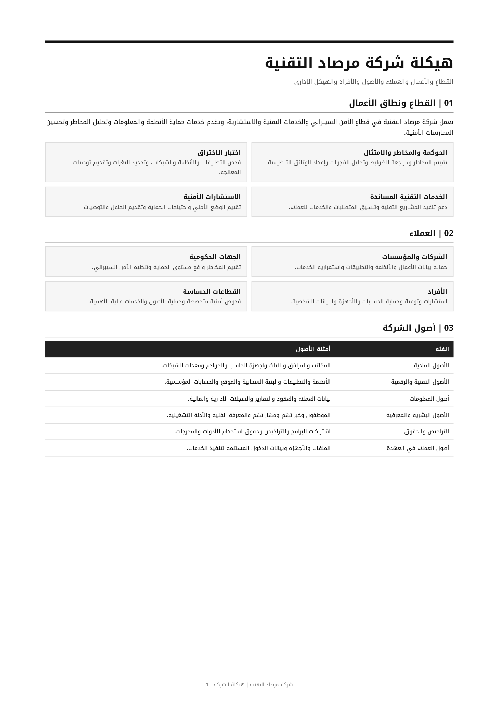
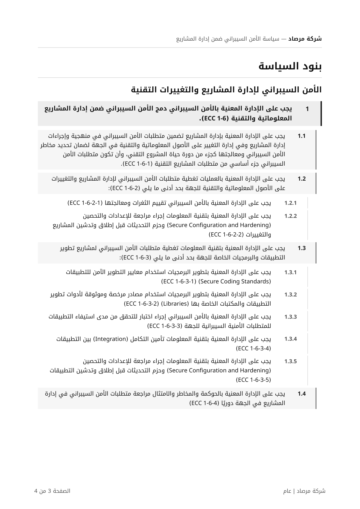
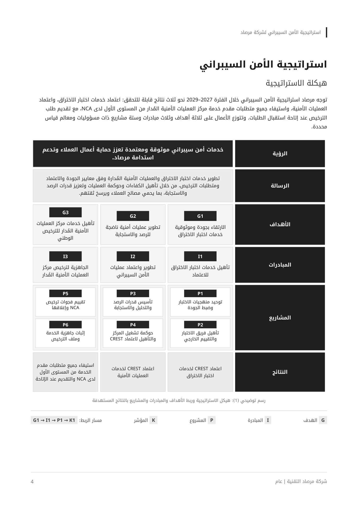
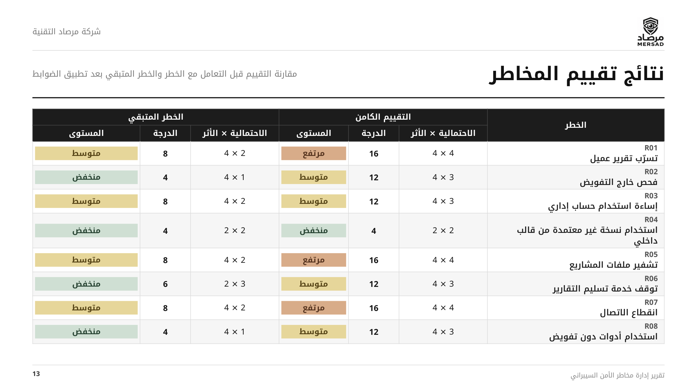

<h1 align="center" dir="rtl">برنامج الحوكمة والمخاطر والامتثال للأمن السيبراني</h1>

  توثيق شخصي للمهام والتطبيقات العملية ضمن برنامج الحوكمة والمخاطر والامتثال في أكاديمية طويق

  <strong>Tuwaiq Academy</strong> · <strong>Cybersecurity GRC Program</strong>

---

<h2 dir="rtl">نبذة عن البرنامج</h2>

برنامج تدريبي عملي يركز على حوكمة الأمن السيبراني، وتقييم المخاطر ومعالجتها، وفهم متطلبات الامتثال التنظيمية، وربط استراتيجية الأمن السيبراني بأهداف المنظمة.

- **الجهة:** أكاديمية طويق (Tuwaiq Academy)
- **البرنامج:** الحوكمة والمخاطر والامتثال (GRC)
- **المدة:** أسبوعان، من 4 إلى 15 أكتوبر 2026
- **الموقع:** الرياض - المقر الرئيسي

<h2 dir="rtl">محاور التعلم</h2>

<ul dir="rtl">
  <li><strong>الحوكمة:</strong> هيكلة المسؤوليات وتطوير سياسات الأمن السيبراني واستراتيجياته.</li>
  <li><strong>إدارة المخاطر:</strong> تحديد المخاطر السيبرانية وتقييمها ومعالجتها.</li>
  <li><strong>الامتثال:</strong> التعرف إلى متطلبات <strong>NCA</strong> و<strong>SAMA</strong> والأطر الدولية مثل <strong>ISO 27001</strong> و<strong>NIST</strong>.</li>
  <li><strong>التطبيق العملي:</strong> تحويل المتطلبات التنظيمية إلى وثائق وضوابط وإجراءات قابلة للتطبيق.</li>
</ul>

---

<h2 dir="rtl">المهام العملية</h2>

<h3 dir="rtl">Task 01 — هيكلة شركة مرصاد التقنية</h3>

بناء هيكل تنظيمي وتشغيلي لشركة افتراضية، شمل الخدمات والعملاء والأصول والأدوار والمسؤوليات.

  

 

 

<h3 dir="rtl">Task 02 — سياسة الأمن السيبراني ضمن إدارة المشاريع</h3>

إعداد سياسة تدمج متطلبات الأمن السيبراني في دورة حياة المشاريع والتغييرات التقنية وفق ضوابط <strong>NCA ECC-2:2024</strong>.

  

 

 

<h3 dir="rtl">Task 03 — استراتيجية الأمن السيبراني</h3>

تطوير استراتيجية لشركة مرصاد تشمل الرؤية والأهداف، وتحليل الوضع الراهن، ومؤشرات الأداء، وخارطة الطريق ونموذج التشغيل.

  

 

 

<h3 dir="rtl">Task 04 — تقييم ضوابط الأمن السيبراني</h3>

تقييم حالة تطبيق ضوابط <strong>NCA ECC</strong> وتحديد الفجوات وإجراءات المعالجة والمسؤوليات المستهدفة.

  

 

 

<h3 dir="rtl">Task 05 — إدارة مخاطر الأمن السيبراني</h3>

تحديد الأصول والمخاطر، وتقييم الاحتمالية والأثر، وتوثيق المعالجات والضوابط والمخاطر المتبقية في سجل موحد.

  

  

 

---

<h2 dir="rtl">منهجية التوثيق</h2>

يوثّق المستودع كل مهمة بوصف مختصر ولقطة شاشة من العمل، دون إرفاق الملفات الأصلية. تُجمع المخرجات المتكررة تحت المهمة نفسها.

> **تنويه:** مرصاد التقنية شركة افتراضية لأغراض التدريب. المستندات المعروضة نماذج تعليمية، وليست سياسات معتمدة لدى منشأة حقيقية، ولا تُعد إثباتًا للامتثال إلى ضوابط NCA.

